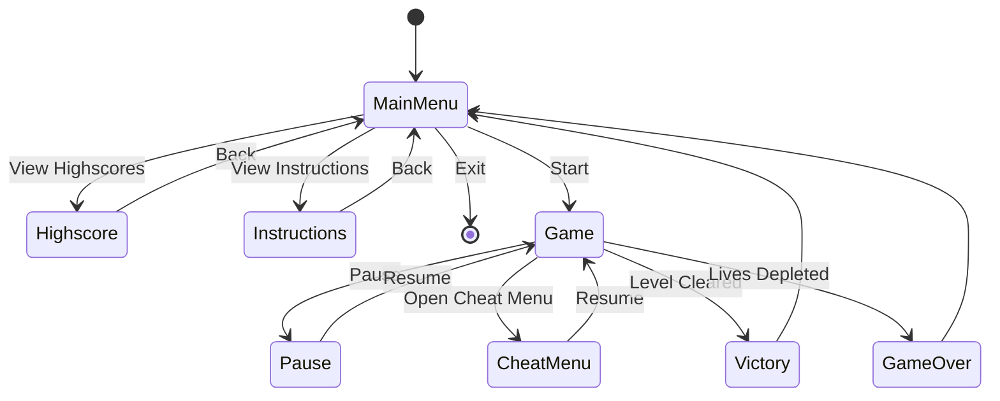
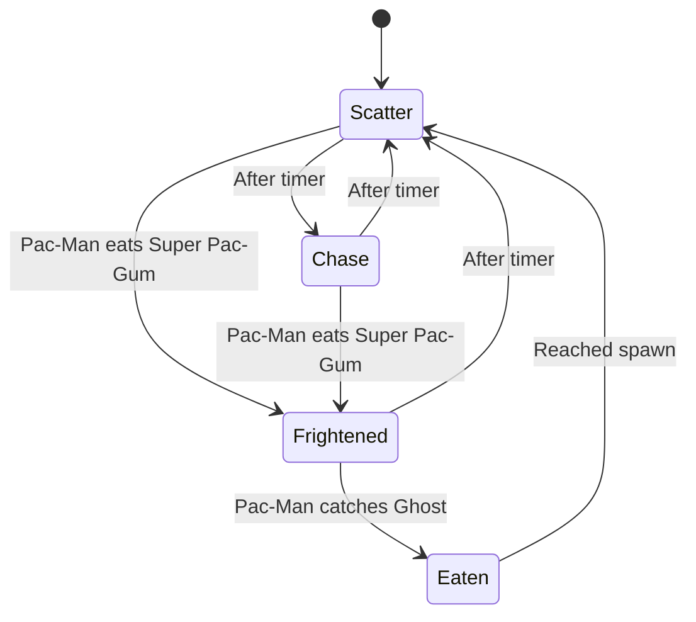
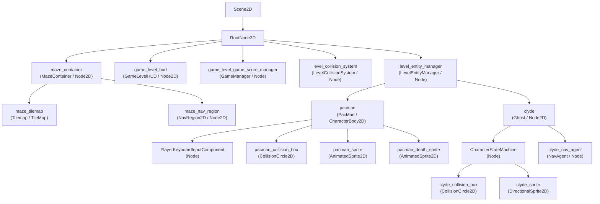

*This project has been created as part of the 42 curriculum by @Caesarovich and @antoine71.*

# Pac-Man

<p align="center">
  <a href="https://www.python.org/">
    
  </a>
  <a href="https://github.com/Caesarovich/Pac-Man/actions/workflows/python-app.yml">
    
  </a>
</p>

<p align="center">
  <strong>Ghosts! More ghosts!</strong><br>
  A modern, configurable recreation of the classic arcade game.
</p>

## Description

**Pac-Man** is a Python recreation of the classic arcade game. The player
navigates procedurally generated mazes, collects Pac-Gums and Super Pac-Gums,
avoids four autonomous ghosts, and progresses through increasingly challenging
levels while trying to achieve the highest possible score.

The game is built on a custom object-oriented 2D engine using Raylib for
rendering and input. Its mazes are produced by the assigned external
`mazegenerator` package and converted into tilemaps, collision layers, and
navigation graphs at runtime. The project also provides configurable gameplay
parameters, persistent highscores, multiple ghost behaviours, pause and cheat
menus, and dedicated victory and game-over screens.

The objective is to complete every level before running out of time or lives.
Eating a Super Pac-Gum temporarily makes ghosts vulnerable, allowing the player
to chase them for additional points. Scores and remaining lives are preserved
between levels.

### Screenshots


## Instructions


### Prerequisites

- Supported operating systems: Linux (Wayland or X11)
- Python 3.14 or higher
- UV package manager

### Installation

1. Clone the repository:
   ```bash
   git clone <repository-url> Pac-Man
   ```

2. Navigate to the project directory:
   ```bash
   cd Pac-Man
   ```

3. Install the required dependencies:
   ```
   make install
   ```

4. Run the game:
   ```bash
   make run
   ```


### Running the game

You can run the game directly with the following command:
```bash
uv run python3 pac-man.py game_config.json
```

This way you can specify a custom configuration file. If no configuration file is provided, the game will use the default `game_config.json` file.

### Controls

- Use arrow keys and Enter to navigate menus and select options.
- Use arrow keys to move Pac-Man in the game.
- Press `P` to pause the game and access the pause menu.
- Press `C` to open the cheat menu during gameplay.
- Press `Esc` to return to exit the game.

### Testing and linting

Linting:
```bash
make lint
make lint-strict
```

Testing:
```bash
make test
```

### Packaging

You can create a standalone executable of the game using the following command:

```bash
make build
```

This will create a standalone executable in the `dist` directory. You can run it directly from there.

## Configuration

The gameplay configuration is loaded from a JSON file. The default configuration file is `game_config.json`, but you can specify a different file when running the game.


### Comment syntax

The loader accepts JSON files with comment lines, but only when the line starts
with `#`.

### Level generation behavior

- Level 1 uses `levels[0]` (width, height, seed).
- For level N > 1:
  - If `levels[N-1]` exists, it is used.
  - Otherwise, width/height are reused from the previous level and `seed` is randomized.

### Configuration reference

| Key | Type | Default | Constraints | Description |
| --- | --- | --- | --- | --- |
| `ready_check_timer` | float | `2.0` | `>= 0.0` | Delay before gameplay starts. |
| `game_timer` | float | `90.0` | `>= 0.0` | Time available for each level. |
| `pacman_death_timer` | float | `1.0` | `>= 0.0` | Duration of death animation/transition. |
| `end_level_timer` | float | `3.0` | `>= 0.0` | Delay before scene transition after level end. |
| `max_levels` | int | `10` | `1..99` | Number of levels required for victory. |
| `levels` | array of objects | `[ {"width": 9, "height": 9, "seed": 42} ]` | min length `1` | Explicit maze definitions. Level 1 uses first entry. |
| `lives` | int | `3` | `1..99` | Starting lives. |
| `points_per_pacgum` | int | `10` | `0..1000` | Score for regular Pac-Gum. |
| `points_per_super_pacgum` | int | `50` | `0..1000` | Score for Super Pac-Gum. |
| `points_per_ghost` | int | `200` | `0..1000` | Score when eating a frightened ghost. |
| `points_per_boost` | int | `300` | `0..1000` | Score gained when collecting a boost. |
| `pacman_speed_boost_per_level` | float | `0.05` | `0.0..1.0` | Added Pac-Man speed factor per level. |
| `ghosts_speed_boost_per_level` | float | `0.05` | `0.0..1.0` | Added ghost speed factor per level. |
| `ghost_base_speed` | float | `2700.0` | `>= 0.0` | Base ghost speed before level scaling. |
| `pacman_base_speed` | float | `3200.0` | `>= 0.0` | Base Pac-Man speed before level scaling. |
| `ghost_collision_box_scale` | float | `0.6` | `>= 0.0` | Ghost collision radius scale. |
| `pacman_collision_box_scale` | float | `0.6` | `>= 0.0` | Pac-Man collision radius scale. |
| `frightened_time` | float | `6.0` | `>= 0.0` | Total frightened mode duration. |
| `flash_time` | float | `1.0` | `>= 0.0`, then forced to `< frightened_time` by runtime validator | End-of-frightened blinking window. |
| `boost_duration` | float | `20.0` | `>= 0.0` | Duration of temporary boost effect. |
| `boost_spawn_chance` | float | `0.1` | `0.0..1.0` | Per-second spawn probability factor (scaled by frame delta). |

`levels[]` entry structure:

| Key | Type | Default | Constraints | Description |
| --- | --- | --- | --- | --- |
| `width` | int | 9 | `3..30`, must match `height` after validation | Maze width in cells. |
| `height` | int | 9 | `3..30` | Maze height in cells. |
| `seed` | int | 0 | integer | Deterministic generation seed for this level. |

## Highscore

The highscore is saved to a `highscore.json` file in the root directory of the project. If you want to reset the highscore, simply delete this file.
We decided to implement it using JSON and Pydantic, as it is a simple and effective way to store this kind of data with validation.

If the file is missing, invalid, or inaccessible, the game will create a new highscore array and continue to function normally. The highscore is loaded at the start of the game and saved whenever a new highscore is achieved.

## Maze Generation

To generate the maze, we use the A-Maze-ing package (version 1.0.0) as an external dependency. The maze generator is integrated through a custom adapter that interfaces with the package's API. It is located in `src/pac_man/mazegen_utils` and is responsible for converting the generated maze data into a format suitable for our game engine.

When generating the maze, we set the `PERFECT` parameter to `False` to allow for more "holes" in the maze, avoiding long corridors which would make the game less interesting. The width, height, and seed parameters are forwarded to the generator to ensure that the maze is generated according to the specified configuration.

## Implementation

### Game screens hierarchy

The game is structured in scenes. Scenes represent the different "screens" of the game, such as the main menu, gameplay, pause menu, and highscore display. Each scene is responsible for its own rendering and input handling, and the scene manager handles transitions between scenes.



### Player, ghosts, and entities

The game's characters and entities are implemented as classes that inherit from a base `CharacterBody2D` class. This class provided composability by allowing the addition of components such as input handling, movement, sprite rendering, collision detection, and state machines.

  ```mermaid
  flowchart LR
      CharacterBody2D -->|may add| InputComponent
      CharacterBody2D -->|may add| MovementComponent
      CharacterBody2D -->|may add| Sprite2D
      CharacterBody2D -->|may add| CollisionObject2D
      CharacterBody2D -->|may add| CharacterStateMachine
      InputComponent -->|events| MovementComponent
  ```


Ghosts movement are implement using a navigation graph traversed by a `NavAgent` component. Pac-Man's movement are implemented using a `NavGraphMovementController` component, which allows for manual input control while still respecting the navigation graph and collision detection.

Ghosts behaviours are implemented using a state machine that defines their different modes: Scatter, Chase, Frightened, and Eaten. The state machine transitions between these modes based on timers and player actions, such as eating a Super Pac-Gum.



### Scoring and collectibles

The score is calculated based on the number of Pac-Gums, Super Pac-Gums, Boost Power-ups, and ghosts eaten. Each type of collectible has a predefined point value, which can be configured in the `game_config.json` file. The score is displayed on the HUD during gameplay and is updated in real-time as the player collects items.

Eating consecutive ghosts during a single frightened mode increases the score multiplier, rewarding players for taking risks.

### User interface and cheat mode

The user interface is implemented as a custom framework inspired by the Arcade UI system. It is fully integrated to the game engine and as such can used in any scene, updated and drawn in the same way as any other node. The UI framework provides components such as buttons, labels, and panels, which can be easily customized and arranged to create menus and HUD elements.

The cheat mode allows players to modify certain gameplay parameters, such as the number of lives, the current level, and the game timer. This feature is intended for testing and debugging purposes.

## General Software Architecture

### Overview

The project is organized into two main directories: `src/pac_man` and `src/engine`. The `pac_man` directory contains the game-specific logic, while the `engine` directory contains the custom engine and its components. The game is structured around a scene manager that handles transitions between different scenes, such as the main menu, gameplay, pause menu, and highscore display.

The game's entrypoint is the `pac_man/main.py` file, which initializes the engine, loads the configuration, and starts the main game loop. The game manager is responsible for managing the current level, player state, and scoring. Entities such as Pac-man and ghosts are implemented as classes with state machines that define their behavior and interactions.

### Project layout

```bash
- src/
  - pac_man/
    - assets/ # Game assets interfaces
    - config/ # Configuration and constants
    - entities/ # Game entities and state machines
    - game/ # Global Entity managers
    - maze/ # Maze and tilemap management
    - mazegen_utils/ # Maze generation adapter
    - resources/ # Sprite sheets and other assets
    - scenes/ # Game scenes (Menu, Game, Pause, etc.)
  - engine/
    - ui/ # UI framework and components
    - navigation/ # Navigation and pathfinding
    - rendering/ # Rendering and post-processing
    - sprites/ # Sprite management and animation
```


### Game Engine

The custom engine is built on top of Raylib and provides a framework for rendering, input handling, and scene management. It includes a UI framework for creating menus and HUD elements, as well as a navigation system for pathfinding and collision detection. The engine also manages resources such as sprite sheets, ensuring that they are loaded and unloaded efficiently.

The engine is designed around the concept of scenes, which encapsulate different parts of the game. Each **Scene** is composed of **Node**s arranged in a tree structure, allowing for hierarchical organization of game objects. The **SceneManager** handles transitions between scenes and manages the lifecycle of nodes.

  ```mermaid
  graph LR
      A[pac_man.main] -->|creates| B[Engine]
      
      B --> D[RenderPipeline]
      B --> C[SceneManager]
      B --> F[pyray Window / Input]

    subgraph Scene Management
      
      C --> G[Scene2D Stack]
    end

    subgraph Node Tree
      G --> H[RootNode2D]
      H --> J[Game objects]

      J --> K[MovementComponent]
      J --> L[InputComponent]
      J --> M[CollisionObject2D]
      J --> N[CharacterStateMachine]
      J --> O[Sprite2D / DirectionalSprite2D]
    end

      subgraph Render
        D --> P[SceneRenderer]
        P --> Q[PostProcessingRenderer]
        Q --> R[draw to window]
      end

      P --> C
  ```

#### Node, Node2D and Tree Structure

The engine follows a Godot-like tree: a scene owns one root, the level adds a
set of sibling gameplay nodes under that root, and each entity can own its own
subtree of sprites, collision shapes, controllers, and state machines. The
example below reflects the actual `GameLevel` composition used by the game.



This structure is what lets different game objects live in the same tree while
still behaving differently. `Node` gives them hierarchy and lifecycle, `Node2D`
adds inherited transforms, and `Sprite2D`-based nodes draw the visual part of
each entity without leaving that shared scene graph.


  **Runtime and rendering stack**

  ```mermaid
  classDiagram
      class Engine {
        +initialize()
        +run()
        +dispose()
        +exit()
      }
      class SceneManager {
        +push(scene)
        +pop()
        +replace(scene)
        +clear_immediately()
      }
      class RenderPipeline {
        +initialize()
        +render()
        +dispose()
        +add_renderer(renderer)
        +remove_renderer(renderer)
      }
      class Renderer {
        <<protocol>>
        +initialize()
        +dispose()
        +render(source_texture)
      }
      class SceneRenderer
      class PostProcessingRenderer
      class Shader {
        <<abstract>>
        +initialize()
        +apply(source, target, scene_texture)
        +dispose()
      }
      class Scene2D {
        +root: RootNode2D
        +_update(dt)
        +_draw()
      }

      Engine *-- SceneManager
      Engine *-- RenderPipeline
      RenderPipeline o-- Renderer
      SceneRenderer ..|> Renderer
      PostProcessingRenderer ..|> Renderer
      SceneRenderer --> SceneManager
      PostProcessingRenderer *-- Shader : pipeline shaders
      SceneManager *-- Scene2D
      SceneRenderer --> Scene2D
  ```

  **Sprite stack**

  ```mermaid
  classDiagram
      class Node2D
      class Sprite2D {
        +texture
        +region
        +tint
        +fit_mode
        +get_draw_size()
        +duplicate()
      }
      class AnimatedSprite2D {
        +frames
        +frame_duration
        +loop
        +play()
        +pause()
      }
      class DirectionalSprite2D {
        +current_direction
        +current_sprite
        +turn(offset)
        +turn_left()
        +turn_right()
      }
      class SpriteSheet {
        +get_frame_count()
        +get_frame_at_index(index)
        +get_frame_at_position(position)
      }
      class SpriteFrame {
        +texture
        +region
        +to_sprite2d()
      }

      Sprite2D --|> Node2D
      AnimatedSprite2D --|> Sprite2D
      DirectionalSprite2D --|> Sprite2D
      AnimatedSprite2D *-- SpriteFrame : frames
      DirectionalSprite2D *-- Sprite2D : directional variants
      SpriteSheet --> SpriteFrame : creates
      SpriteFrame --> Sprite2D : converts to
  ```


  **Navigation and movement stack**

  ```mermaid
  classDiagram
      class NavGraph2D
      class NavNode2D {
        +id
        +position
        +edges
        +get_next_node(direction)
      }
      class NavEdge2D {
        +id
        +cost
        +node_from
        +node_to
        +get_travel_direction()
      }
      class NavRegion2D {
        +graph
        +recalculate_costs()
      }
      class NavRoute
      class NavDirection
      class Pathfinder {
        +find_route(graph, start_node, end_node)
      }
      class AStarPathfinder {
        +heuristic(node_a, node_b)
        +find_route(graph, start_node, end_node)
      }
      class NavAgent {
        +set_current_node(node)
        +set_target_node(node)
        +find_route(start_node, end_node)
        +move_along_route(distance)
        +get_current_position_global()
      }
      class NavGraphMovementController {
        +set_initial_direction(direction)
        +set_current_node(node)
        +move_along_route(distance)
        +on_notify(entity, event)
      }

      NavRegion2D --|> Node2D
      NavRegion2D *-- NavGraph2D
      NavGraph2D *-- NavNode2D
      NavGraph2D *-- NavEdge2D
      NavNode2D --> NavEdge2D : outgoing edges
      NavAgent o-- NavGraph2D
      NavAgent o-- Pathfinder
      AStarPathfinder --|> Pathfinder
      NavGraphMovementController o-- NavGraph2D
      NavGraphMovementController --> NavDirection
      NavAgent --> NavRoute
      NavRoute *-- NavNode2D
      NavRoute *-- NavEdge2D
  ```

  **Events and observers**

  The application uses a small observer network to connect input, collision,
  gameplay state, and HUD updates. The diagram below shows the main emitters,
  the observers they notify, and how gameplay events propagate through the
  scene.

  ```mermaid
  flowchart

    subgraph Collision[Collision]
      ObjectResolver[ObjectCollisionResolver]
      TileResolver[TileMapCollisionResolver]
      CollisionHandler[PacManCollisionHandler]
    end

    subgraph Gameplay[Gameplay]
      GameManager[GameManager]
      Ghost[Ghost]
      GhostMachine[CharacterStateMachine]
      CharacterState[CharacterState]
    end

    subgraph HUD[HUD]
      ScoreController[UIScoreController]
      StateController[UIGameStateController]
      GameLevel[GameLevel]
    end

    ObjectResolver -->|emits ObjectCollisionEvent| CollisionHandler
    TileResolver -->|emits TileCollisionEvent| CollisionHandler

    CollisionHandler -->|emits PacManEvent| GameManager
    CollisionHandler -->|emits PacManEvent| Ghost

    Ghost -->|forwards PacManEvent| GhostMachine
    GhostMachine -->|updates| CharacterState

    GameManager -->|emits ScoreEvent| ScoreController
    GameManager -->|emits GameState| StateController
    GameManager -->|emits GameState| GameLevel
  ```


## Project Management

We used GitHub Projects to manage the development of the game. It is a helpful tool that integrates with GitHub issues and pull requests, allowing us to track progress, assign tasks, and prioritize features


Everyday we disscussed about the tasks we were working one, the different challenges we faced, and the next steps to take. We also used GitHub issues to track bugs and feature requests, and we created pull requests for code reviews and collaboration.


### Task distribution

**Caesarovich**: 
- Game engine
  - Node system
  - sprite management
  - scene management
  - tilemap system
  - rendering pipeline
  - navigation and pathfinding
- Game 
  - Menu scenes (Main menu, highscore, pause, victory, game-over)
  - Ghosts AI and state machine
  - Boost power-up
  - CRT Shader

**antoine71**:
- Engine:
  - Input handling
  - Collision detection and resolution
  - Event system and observer pattern
  - UI framework and components
  - Character state machine and movement controller
- Game
  - Maze generation and adapter
  - Pac-Man movement and collision
  - Game manager and scoring system
  - HUD and UI integration
  - Configuration management and validation
  - Parsing and loading of game assets
  - Cheat mode implementation

### General project statistics

```
━━━━━━━━━━━━━━━━━━━━━━━━━━━━━━━━━━━━━━━━━━━━━━━━━━━━━━━━━━━━━━━━━━━━━━━━━━━━━━━━━
 Language              Files        Lines         Code     Comments       Blanks
━━━━━━━━━━━━━━━━━━━━━━━━━━━━━━━━━━━━━━━━━━━━━━━━━━━━━━━━━━━━━━━━━━━━━━━━━━━━━━━━━
 HLSL                      8          420          308           22           90
 JSON                      1           45           37            0            8
 Makefile                  1          100           77            5           18
 Nix                       1           31           29            0            2
 Python                  124        13713        11636           95         1982
 TOML                      1           60           47            4            9
 YAML                      4          252          230           11           11
─────────────────────────────────────────────────────────────────────────────────
 Markdown                  1          593            0          463          130
 |- BASH                   1           23           23            0            0
 (Total)                              616           23          463          130
━━━━━━━━━━━━━━━━━━━━━━━━━━━━━━━━━━━━━━━━━━━━━━━━━━━━━━━━━━━━━━━━━━━━━━━━━━━━━━━━━
 Total                   141        15237        12387          600         2250
━━━━━━━━━━━━━━━━━━━━━━━━━━━━━━━━━━━━━━━━━━━━━━━━━━━━━━━━━━━━━━━━━━━━━━━━━━━━━━━━━
```


You can find these "Project management proofs" under the `docs` directory, including the GitHub Projects board screenshot, the Kanban board screenshot, and the commit statistics graph.

## Publishing

The game is packaged as a standalone executable using PyInstaller. The `Makefile` includes a `build` target that creates the executable in the `dist` directory. The executable can be run directly without requiring Python or any dependencies to be installed on the target system.

## Resources

- [The Pac-Man Dossier](https://pacman.holenet.info/)
- [Raylib](https://www.raylib.com/)
- [Raylib Postprocessing](https://docs.meatcorps.nl/raylibcs/postprocessing/)
- [Raylib Python Bindings](https://pypi.org/project/raylib/)
- [Pac-Man 1.net](https://www.pacman1.net/)
- [Godot Engine Documentation](https://docs.godotengine.org/en/stable/)
- [Arcade Game Engine](https://arcade.academy/)
- [Game design patterns](http://gameprogrammingpatterns.com/)
- [Pydantic](https://docs.pydantic.dev/)
